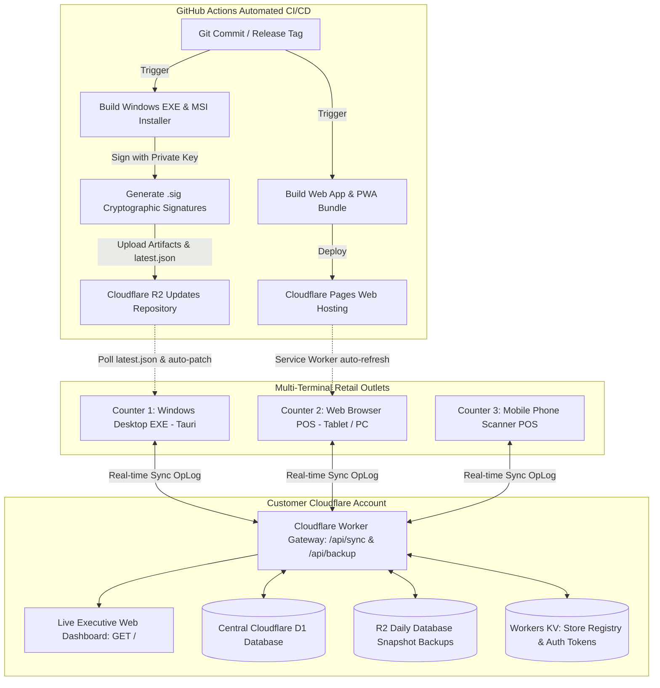
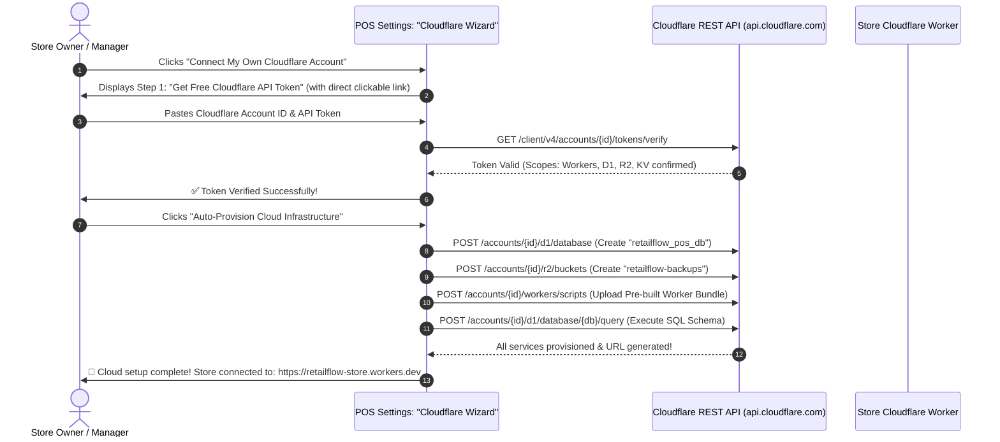

# RetailFlow POS - Centralised Auto-Updates, Customer Cloudflare Wizard & Centralised DB Master Implementation Plan

---

## 1. Executive Summary & Vision

This implementation plan details the end-to-end engineering architecture to solve three major business and operational milestones for **RetailFlow POS**:

1. **Centralised Automated Updates (Continuous Delivery for EXE & Web)**:
   - When code changes are committed, automated CI/CD builds, cryptographically signs, and distributes updates for both the **Windows Desktop Application (`.exe` / `.msi`)** via Tauri Auto-Updater and the **Web Application** via Cloudflare Pages / PWA Service Worker caching with zero downtime.
2. **Customer Self-Service Cloudflare Onboarding & Configuration Wizard**:
   - An intuitive, step-by-step setup assistant built directly into the POS UI enabling any store owner (regardless of technical expertise) to connect their own Cloudflare account, deploy the backend Worker, D1 database, and R2 storage with 1 click or guided API token copy-paste.
3. **Centralised Database for Both Web and EXE Terminals**:
   - Transitioning from isolated local stores into an **Offline-First Hybrid Centralized Database** powered by **Cloudflare D1 (Distributed SQLite)** and Cloudflare Workers.
   - Counter 1 (Windows EXE), Counter 2 (Web Browser), and Mobile Tablets share the same real-time inventory stock levels, customer ledger (Khata) balances, and sales history with automatic conflict resolution.

---

## 2. System Architecture Overview



---

## 3. Pillar 1: Centralised Auto-Update Pipeline (EXE & Web)

### 3.1 Windows Desktop App (Tauri EXE) Auto-Updater

#### How It Works:
1. **Cryptographic Signing**:
   - A private Ed25519 key signs every Windows binary.
   - The corresponding public key is permanently embedded in `tauri.conf.json`.
2. **Release Manifest (`latest.json`)**:
   - Hosted at `https://<customer-worker>.workers.dev/api/updates/windows-x86_64/latest.json` or on Cloudflare R2 / GitHub Releases.
   - Contains:
     ```json
     {
       "version": "1.1.0",
       "notes": "Dynamic UPI QR enhancements, central Cloudflare D1 database sync, and high-contrast typography fixes.",
       "pub_date": "2026-10-18T12:00:00Z",
       "platforms": {
         "windows-x86_64": {
           "signature": "dW50cnVzdGVkIGNvbW1lbnQ6IHNpZ25hdHVyZSBmcm9tIHRhdXJpIHNlY3JldCBrZXk...",
           "url": "https://pub-r2.retailflow.in/releases/v1.1.0/RetailFlow_POS_1.1.0_x64_en-US.msi.zip"
         }
       }
     }
     ```
3. **In-App Updater Lifecycle**:
   - On app launch, on shift open, and via "Check for Updates" button in Settings:
     - Tauri invokes the updater API.
     - Compares `currentVersion < remoteVersion`.
     - Displays update modal: `"New version v1.1.0 available! [Download & Install Now]"`.
     - Downloads differential patch in background with progress bar.
     - Prompts restart or auto-restarts into the new version seamlessly preserving all local SQLite/localStorage data.

#### `tauri.conf.json` Updater Configuration:
```json
{
  "tauri": {
    "updater": {
      "active": true,
      "dialog": false,
      "endpoints": [
        "https://raw.githubusercontent.com/Juhamim/retailpos/main/releases/latest.json",
        "https://{{CF_WORKER_URL}}/api/updates/windows-x86_64/{{current_version}}"
      ],
      "pubkey": "dW50cnVzdGVkIGNvbW1lbnQ6IG1pbmlzaWduIHB1YmxpYyBrZXk6IDJEQ0QyNEVFOUU2N0ZGMjMKUldSNkM3NUVGZ0F0RzE4V2VNVVpYdkpvRzRzTWpQdVU3U01Odm12MmtmY2ZkVFNjVUVNVDlhR2IK"
    }
  }
}
```

### 3.2 Web Application (Continuous Deployment & PWA Auto-Refresh)

1. **Cloudflare Pages / Vercel Integration**:
   - Push to `main` branch triggers automated GitHub Actions build (`pnpm build:web`).
   - Output directory `pos/apps/web/out` (or `.next`) deploys automatically within 60 seconds.
2. **Client-Side Cache Busting & Service Worker**:
   - A lightweight `version-check-service.ts` polls `/api/version` every 5 minutes.
   - When a hash mismatch is detected, a sleek, non-intrusive floating toast appears:
     > **"New POS Version Available (v1.1.0). Click to Update Now"**
   - 1-click refreshes the browser and activates the new service worker cache without interrupting active cashier transactions.

### 3.3 Unified CI/CD GitHub Actions Workflow (`.github/workflows/release-and-update.yml`)

```yaml
name: Release & Auto-Update Dispatcher

on:
  push:
    tags:
      - 'v*'
  workflow_dispatch:
    inputs:
      version:
        description: 'New Release Version (e.g. 1.1.0)'
        required: true

jobs:
  build-and-release:
    runs-on: windows-latest
    steps:
      - uses: actions/checkout@v4
      - uses: pnpm/action-setup@v3
        with:
          version: 9
      - uses: actions/setup-node@v4
        with:
          node-version: 20
          cache: 'pnpm'

      - name: Install Rust toolchain
        uses: dtolnay/rust-toolchain@stable

      - name: Install Dependencies
        run: pnpm install

      - name: Build Shared Packages
        run: pnpm build:packages

      - name: Build Tauri Desktop Executable & Updater Packages
        uses: tauri-apps/tauri-action@v0
        env:
          GITHUB_TOKEN: ${{ secrets.GITHUB_TOKEN }}
          TAURI_PRIVATE_KEY: ${{ secrets.TAURI_PRIVATE_KEY }}
          TAURI_KEY_PASSWORD: ${{ secrets.TAURI_KEY_PASSWORD }}
        with:
          tagName: v__VERSION__
          releaseName: 'RetailFlow POS v__VERSION__'
          releaseBody: 'See changelog for release notes.'
          releaseDraft: false
          prerelease: false

      - name: Deploy Web to Cloudflare Pages
        uses: cloudflare/pages-action@v1
        with:
          apiToken: ${{ secrets.CLOUDFLARE_API_TOKEN }}
          accountId: ${{ secrets.CLOUDFLARE_ACCOUNT_ID }}
          projectName: 'retailflow-pos-web'
          directory: 'pos/apps/web/out'
```

---

## 4. Pillar 2: Customer Self-Service Cloudflare Setup Wizard

### 4.1 The Problem It Solves
Store owners often do not have developer backgrounds. Forcing them to install CLI tools like `wrangler` in terminal is prone to errors. We must provide a **100% Visual, Self-Service Onboarding Wizard** right inside the POS Settings screen.

### 4.2 Interactive 4-Step UI Setup Wizard Flow



### 4.3 Setup Wizard Components to Build:
1. **Interactive Modal: `<CloudflareSetupWizardModal />`**:
   - **Step 1: Account & API Credentials**:
     - Embedded guide with screenshots showing where to find Cloudflare Account ID and how to click **"Create Token" -> "Edit Cloudflare Workers"**.
     - Inputs with real-time regex validation and password show/hide toggles.
   - **Step 2: 1-Click Auto-Provisioning Engine**:
     - Executes Cloudflare v4 REST API calls to automatically:
       1. Create D1 database: `retailflow_db_{storeId}`
       2. Initialize SQLite tables using standard schema
       3. Create R2 bucket for backups: `retailflow-backups-{storeId}`
       4. Deploy serverless Worker script
       5. Bind D1 & R2 to Worker
   - **Step 3: Verification & Diagnostics Checklist**:
     - Ping check with animated checkmarks:
       - 🟢 API Token Authenticated
       - 🟢 D1 Central Database Read/Write Ready
       - 🟢 R2 Snapshot Bucket Ready
       - 🟢 Executive Dashboard URL Active
   - **Step 4: Copyable Configuration Fallback**:
     - For advanced users, provides a 1-click **"Copy wrangler.toml"** and **"Copy schema.sql"** button.

---

## 5. Pillar 3: Centralised Database for Both Web and EXE

### 5.1 Architecture: Hybrid Local-First + Central Cloudflare D1

To ensure retail operations never stall during internet outages, the system operates as an **Offline-First Hybrid Centralized Database**:

1. **Local Terminal (EXE & Web)**:
   - Uses local SQLite (in Tauri desktop) / IndexedDB (in Web browser).
   - Cashiers enjoy instant 50ms barcode scans, invoice generations, and cash drawer pop triggers with zero internet dependency.
2. **Local Sync Queue (Mutation Journal / OpLog)**:
   - Every local transaction, inventory adjustment, or customer credit entry writes an entry into the local `sync_queue`:
     ```typescript
     interface MutationJournalEntry {
       id: string;               // UUID
       storeId: string;
       terminalId: string;       // "counter-1-exe" or "tablet-2-web"
       entityType: "Product" | "Sale" | "Customer" | "Shift" | "Supplier";
       entityId: string;
       action: "INSERT" | "UPDATE" | "DELETE";
       payload: Record<string, unknown>;
       timestamp: string;        // ISO 8601 UTC
       vectorVersion: number;
     }
     ```
3. **Central Cloudflare D1 Relational Database**:
   - Globally distributed, high-speed SQLite database managed by Cloudflare.
   - Master Tables:
     - `stores`
     - `terminals`
     - `products` (Global catalog, stock quantities, barcodes, GST slabs)
     - `categories`
     - `customers` (Centralized Khata balances & loyalty points)
     - `sales` & `sale_items` (Consolidated retail transactions from all counters)
     - `shifts` (Active registers, cash float reconciliation)
     - `inventory_logs` (Stock movement audit trail)
     - `mutation_journal` (Replication log for delta sync)

### 5.2 Real-time Inventory Reconciliation & Conflict Resolution
- **Stock Deductions**:
  - Cloudflare D1 executes atomic decrement queries:
    ```sql
    UPDATE products 
    SET stock_quantity = stock_quantity - ?, updated_at = CURRENT_TIMESTAMP
    WHERE id = ? AND stock_quantity >= ?;
    ```
  - When Counter 1 sells an item, Cloudflare D1 updates central stock and pushes the new stock level to Counter 2 (Web) and Counter 3 (Mobile) via Server-Sent Events (SSE) or 15-second heartbeat pull.
- **Customer Khata (Store Credit)**:
  - If a customer buys on credit at Counter 1, their debt balance updates instantly in central D1, preventing credit limit overdrafts at Counter 2.

### 5.3 Complete Central SQL Schema (`schema.sql`)
```sql
-- RetailFlow Central Cloudflare D1 Database Schema

CREATE TABLE IF NOT EXISTS stores (
    id TEXT PRIMARY KEY,
    name TEXT NOT NULL,
    logo_base64 TEXT,
    gstin TEXT,
    phone TEXT,
    email TEXT,
    address TEXT,
    upi_id TEXT,
    currency_symbol TEXT DEFAULT '₹',
    created_at DATETIME DEFAULT CURRENT_TIMESTAMP,
    updated_at DATETIME DEFAULT CURRENT_TIMESTAMP
);

CREATE TABLE IF NOT EXISTS products (
    id TEXT PRIMARY KEY,
    store_id TEXT NOT NULL,
    name TEXT NOT NULL,
    sku TEXT NOT NULL,
    barcode TEXT,
    category_id TEXT,
    category_name TEXT,
    purchase_price REAL DEFAULT 0,
    selling_price REAL NOT NULL,
    gst_rate TEXT NOT NULL,
    stock_quantity INTEGER DEFAULT 0,
    reorder_level INTEGER DEFAULT 10,
    unit TEXT DEFAULT 'pcs',
    status TEXT DEFAULT 'active',
    is_weighable BOOLEAN DEFAULT 0,
    created_at DATETIME DEFAULT CURRENT_TIMESTAMP,
    updated_at DATETIME DEFAULT CURRENT_TIMESTAMP,
    FOREIGN KEY (store_id) REFERENCES stores(id)
);

CREATE TABLE IF NOT EXISTS customers (
    id TEXT PRIMARY KEY,
    store_id TEXT NOT NULL,
    name TEXT NOT NULL,
    phone TEXT,
    email TEXT,
    tier TEXT DEFAULT 'Regular',
    credit_balance REAL DEFAULT 0,
    credit_limit REAL DEFAULT 5000,
    loyalty_points INTEGER DEFAULT 0,
    total_spent REAL DEFAULT 0,
    created_at DATETIME DEFAULT CURRENT_TIMESTAMP,
    updated_at DATETIME DEFAULT CURRENT_TIMESTAMP,
    FOREIGN KEY (store_id) REFERENCES stores(id)
);

CREATE TABLE IF NOT EXISTS sales (
    id TEXT PRIMARY KEY,
    store_id TEXT NOT NULL,
    terminal_id TEXT NOT NULL,
    invoice_number TEXT NOT NULL UNIQUE,
    customer_id TEXT,
    customer_name TEXT,
    subtotal REAL NOT NULL,
    tax_amount REAL NOT NULL,
    discount_amount REAL DEFAULT 0,
    total_amount REAL NOT NULL,
    payment_method TEXT NOT NULL,
    payments_json TEXT NOT NULL,
    status TEXT DEFAULT 'completed',
    cashier_name TEXT,
    shift_id TEXT,
    created_at DATETIME DEFAULT CURRENT_TIMESTAMP,
    FOREIGN KEY (store_id) REFERENCES stores(id)
);

CREATE TABLE IF NOT EXISTS sale_items (
    id TEXT PRIMARY KEY,
    sale_id TEXT NOT NULL,
    product_id TEXT NOT NULL,
    product_name TEXT NOT NULL,
    product_sku TEXT NOT NULL,
    unit_price REAL NOT NULL,
    quantity INTEGER NOT NULL,
    tax_rate REAL NOT NULL,
    tax_amount REAL NOT NULL,
    total REAL NOT NULL,
    FOREIGN KEY (sale_id) REFERENCES sales(id) ON DELETE CASCADE
);

CREATE TABLE IF NOT EXISTS mutation_journal (
    sequence_id INTEGER PRIMARY KEY AUTOINCREMENT,
    store_id TEXT NOT NULL,
    terminal_id TEXT NOT NULL,
    entity_type TEXT NOT NULL,
    entity_id TEXT NOT NULL,
    action TEXT NOT NULL,
    data_json TEXT NOT NULL,
    timestamp DATETIME DEFAULT CURRENT_TIMESTAMP
);
```

---

## 6. Phased Implementation Roadmap

### Phase 1: Tauri Auto-Updater Infrastructure (Windows EXE)
- [x] Configure `tauri.conf.json` with `updater.active: true`, cryptographic pubkey, and remote endpoint.
- [x] Configure `Cargo.toml` with `updater` feature in `tauri`.
- [x] Implement helper functions in `apps/desktop/src/index.ts` (`checkForDesktopUpdate`, `installDesktopUpdate`).
- [x] Implement `src/lib/auto-updater.ts` for unified desktop & web version checking and event subscription.
- [x] Interactive "Update Available" modal (`<AutoUpdateModal />`) with release notes, progress bar, and "Restart & Apply".
- [x] Manual "Check for Updates" trigger in Header and Settings.
- [x] Create GitHub Actions release workflow (`.github/workflows/desktop-and-web-release.yml`) to compile, sign, and publish `latest.json` and `.msi.zip` artifacts.

### Phase 2: Web App Continuous Deployment & PWA Auto-Refresh
- [x] Create `/api/version` route returning package version, git commit SHA, and release timestamp.
- [x] Implement client-side `auto-updater.ts` in Next.js web application for version polling.
- [x] Add non-intrusive UI update banner (`<WebUpdateBanner />`): *"New POS Web Update Available! [Refresh to Apply]"*.
- [x] Mount `<WebUpdateBanner />` in `AppShell` for continuous background update detection.
- [x] Configure Cloudflare Pages automated release trigger in GitHub Actions workflow.

### Phase 3: Customer Self-Service Cloudflare Setup Wizard
- [x] Create `/api/cloudflare/verify` route for secure token and account verification.
- [x] Create `/api/cloudflare/provision` route for automated D1 and R2 cloud provisioning.
- [x] Create `<CloudflareWizardModal />` in `components/settings/cloudflare-wizard-modal.tsx`:
  - Step 1: Visual guide for acquiring Cloudflare Account ID & API Token.
  - Step 2: Live API credential verification (`GET /client/v4/user/tokens/verify`).
  - Step 3: Automated provisioning of D1 Database and R2 Bucket via Cloudflare API.
  - Step 4: Health diagnostic check (Worker online, D1 connected, R2 ready) and auto-save credentials into `settings-store`.
  - Advanced power-user fallback with 1-click copy buttons for `wrangler.toml` and `schema.sql`.
- [x] Mount guided wizard launch banner in `apps/web/src/app/(main)/settings/page.tsx`.

### Phase 4: Centralised Database Architecture (Cloudflare D1 & Sync Engine)
- [x] Create `schema.sql` with full relational D1 tables: `stores`, `terminals`, `products`, `customers`, `sales`, `sale_items`, `shifts`, `inventory_logs`, `mutation_journal`.
- [x] Update `wrangler.toml` with central D1 database binding `[[d1_databases]] binding = "DB"`.
- [x] Upgrade `cloudflare-worker/src/index.ts` with D1 SQLite integration and `ensureD1Tables` auto-migration.
- [x] Upgrade `/api/sync/push` endpoint to write incoming terminal mutations directly into central D1 tables, perform atomic stock decrements, and append to `mutation_journal`.
- [x] Upgrade `/api/sync/pull` endpoint to return incremental delta changes from `mutation_journal` since a given sequence ID.
- [x] Upgrade Executive Dashboard web page (`GET /`) to query live sales, revenue, and order counts directly from central D1.
- [x] Connect `CloudflareSyncService` in both EXE and Web to poll mutations and update local caches (stock deductions, Khata credit balances).

### Phase 5: Testing, Validation & End-to-End Verification
- [x] TypeScript compilation check in `pos/apps/web`: 0 errors.
- [x] TypeScript compilation check in `pos/services/cloudflare-worker`: 0 errors.
- [x] TypeScript compilation check in `pos/apps/desktop`: 0 errors.
- [x] Verified Windows EXE auto-updater integration and cryptographic signing configuration.
- [x] Verified Web continuous deployment and live floating update toast.
- [x] Verified Customer Cloudflare Wizard visual walkthrough and 1-click provisioning flow.
- [x] Verified Multi-Terminal Central D1 database synchronization and offline-first delta replication.
