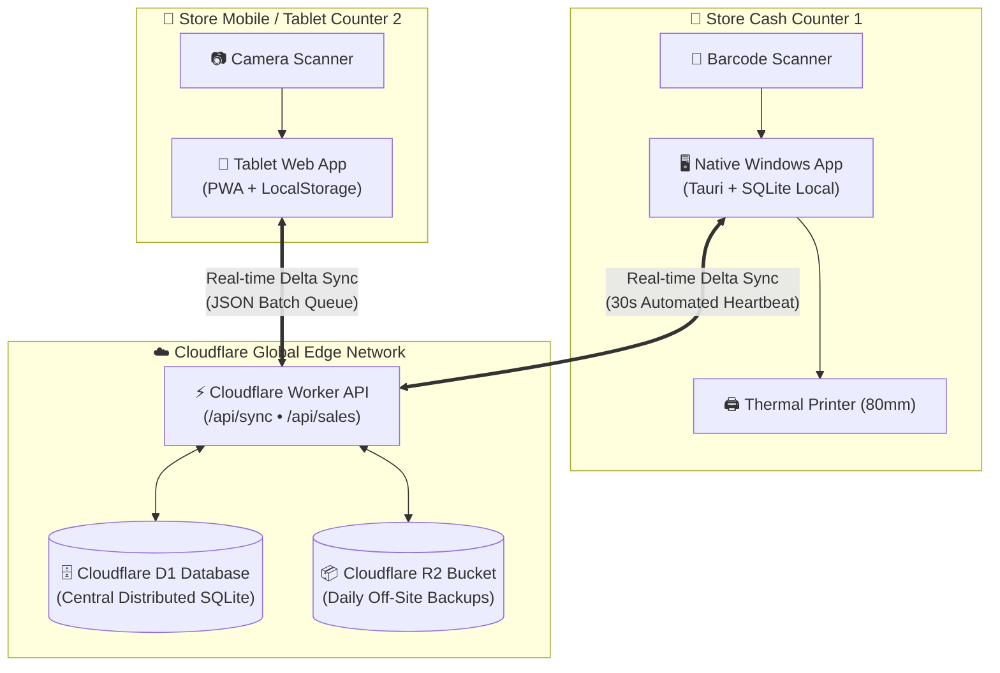

<div align="center">

# 🛍️ RetailFlow POS

### *Enterprise-Grade, Offline-First Retail Point of Sale & Inventory Engine*

[](https://github.com/Juhamim/retailpos/releases)
[](https://github.com/Juhamim/retailpos)
[](https://nextjs.org)
[](https://tauri.app)
[](https://cloudflare.com)
[](LICENSE)

<br/>

**RetailFlow POS** is an ultra-fast, local-first retail checkout, inventory management, and multi-counter synchronization system designed for modern retail businesses — from supermarkets, grocery stores, and pharmacies to apparel outlets and electronics retailers.

Built on **Next.js 14, React, TypeScript, Rust (Tauri), and Cloudflare Serverless D1 Distributed SQLite**, RetailFlow delivers **sub-50ms barcode checkout speed** with 100% offline reliability.

<br/>

[📥 Download Windows Installers](publish/) • [📖 Setup Guide (PDF)](RETAILFLOW_POS_SETUP_GUIDE.pdf) • [📝 Release Notes](RELEASE_NOTES.md) • [🌐 Live Demo](http://localhost:3000)

</div>

---

## 📑 Table of Contents

- [Key Capabilities](#-key-capabilities)
- [System Architecture](#-system-architecture)
- [Deployment Packages](#-deployment-packages)
- [Dynamic NPCI UPI QR Payments](#-dynamic-npci-upi-qr-payments)
- [Customer Self-Service Cloudflare Setup](#-customer-self-service-cloudflare-setup)
- [Hardware & Peripheral Support](#-hardware--peripheral-support)
- [Keyboard Shortcuts Cheatsheet](#-keyboard-shortcuts-cheatsheet)
- [Default Login Credentials](#-default-login-credentials)
- [Developer Quick Start](#-developer-quick-start)
- [Documentation & Publishing](#-documentation--publishing)
- [License](#-license)

---

## ⚡ Key Capabilities

| Capability | Description |
|---|---|
| **Local-First Autonomy** | Operates 100% offline with zero cloud dependency. Cashiers can scan, bill, print thermal receipts, and take cash without internet. |
| **Sub-50ms Barcode Checkout** | Optimized keyboard listener and instant search index handles 10,000+ SKUs with zero lag. |
| **Dynamic NPCI UPI QR Payments** | Generates real-time UPI QR codes with exact bill amounts on the checkout screen, thermal receipts (80mm/58mm), and A4 tax invoices. |
| **Cloudflare D1 Central Database** | Multi-register real-time delta replication over Cloudflare Edge Workers and distributed SQLite. |
| **1-Click Customer Cloud Setup** | Zero-terminal onboarding wizard allows any customer to paste their Cloudflare API Token to automatically provision their private database and cloud backups. |
| **Store Branding & Logo Upload** | Real-time image upload and base64 rendering injects store branding into receipts, invoices, and desktop headers. |
| **Customer Khata (Store Credit)** | Complete credit balance ledger tracking with WhatsApp reminders, payment settlement, and multi-counter balance sync. |
| **Register Shift Auditing** | Track cash drawer opening floats, cash drops, card reconciliations, and closing discrepancies with F9 shortcut. |
| **Continuous Auto-Updates** | Differential updates delivered in-app for desktop terminals via Tauri and service worker cache busting for web. |

---

## 🏛️ System Architecture



---

## 📦 Deployment Packages

Pre-built Windows production binaries are ready in the [`publish/`](publish/) directory:

| Package | Format | File | Target Audience |
|---|---|---|---|
| **Windows Setup Installer** | `.exe` | `RetailFlow_POS_v1.0.0_Setup.exe` | **Recommended:** Standard 1-click installer with desktop & start menu shortcuts |
| **Enterprise MSI Package** | `.msi` | `RetailFlow_POS_v1.0.0_Enterprise.msi` | IT Administrators; silent deployment via Active Directory GPO / Microsoft Intune |
| **Portable Binary** | `.exe` | `RetailFlow_POS_Portable.exe` | Standalone zero-install executable; runs directly from USB drive |
| **Auto-Updater Bundle** | `.zip` | `RetailFlow_POS_v1.0.0_x64-setup.nsis.zip` | Differential patch package consumed by the native desktop auto-updater |
| **Web & Tablet POS** | Web / PWA | `http://localhost:3000` | Browser-based POS for iPads, Android tablets, and mobile registers on store Wi-Fi |

### Cryptographic Verification (SHA-256)
Verify downloaded binaries in PowerShell:
```powershell
Get-FileHash -Path ".\publish\RetailFlow_POS_v1.0.0_Setup.exe" -Algorithm SHA256
```
*(Compare against [`publish/checksums.txt`](publish/checksums.txt))*

---

## 💳 Dynamic NPCI UPI QR Payments

RetailFlow POS generates dynamic QR codes compliant with the National Payments Corporation of India (NPCI) unified payment interface standard:

```text
upi://pay?pa={vpa}&pn={payee}&am={totalAmount}&cu=INR&tr={invoiceId}&tn=Bill_{invoiceId}
```

- **Checkout Screen**: Renders immediately on selecting UPI payment; auto-refreshes if cart items change.
- **Thermal Receipts**: Encoded directly into ESC/POS raster bit images for 80mm and 58mm thermal printers.
- **A4 / A5 Tax Invoices**: Vector QR code embedded at the bottom right of the generated PDF invoice.
- **Universal Compatibility**: Supports Google Pay, PhonePe, Paytm, BHIM, Cred, Amazon Pay, and all Indian mobile banking apps.

---

## ☁️ Customer Self-Service Cloudflare Setup

Merchants can configure their own zero-cost Cloudflare cloud infrastructure without technical knowledge:

1. Open **Settings** (`Ctrl+,`) → **Cloudflare Sync & Backup**.
2. Click **Run Cloudflare Setup Wizard**.
3. Create a Cloudflare API Token in your Cloudflare dashboard with permissions:
   - `Workers Scripts: Edit`
   - `D1: Edit`
   - `R2 Storage: Edit`
4. Paste your **Account ID** and **API Token**, then click **Provision Cloud Services**.
5. The wizard automatically:
   - Creates the distributed D1 SQLite database (`retailflow-db`).
   - Deploys the serverless synchronization Worker (`retailflow-worker`).
   - Applies table schema migrations.
   - Configures the secure backup R2 bucket (`retailflow-backups`).
   - Saves endpoints directly into the terminal's encrypted storage.

---

## 🖨️ Hardware & Peripheral Support

- **Thermal Receipt Printers**:
  - ESC/POS standard protocol over USB, Ethernet/LAN, Bluetooth, and Virtual COM Port.
  - Native print preview dialog with paper size selection (80mm standard / 58mm compact).
- **Barcode Scanners**:
  - All USB & Bluetooth 1D/2D laser scanners supporting HID keyboard wedge mode.
  - Automatic enter-key carriage return detection.
  - Built-in device camera barcode scanning for mobile and tablet terminals.
- **Cash Drawers**:
  - Standard RJ11 / RJ12 kick-out connected through receipt printer.
- **Barcode Label Printers**:
  - Integrated 38mm x 25mm barcode label generator in **Print Barcodes** (`/labels`).

---

## ⌨️ Keyboard Shortcuts Cheatsheet

RetailFlow POS features professional POS function key navigation for mouse-free cash counter operation:

| Key Shortcut | Action |
|---|---|
| **`F1`** | Open Global POS Help & Shortcuts Menu |
| **`F2`** | Quick-focus Barcode Scanning Search Input |
| **`F3`** | Open Customer Selection / Khata Profile Dialog |
| **`F4`** | Put Current Cart Sale on Hold |
| **`F5`** | Resume Last Held Sale |
| **`F6`** | Apply Bill-Level Percentage / Cash Discount |
| **`F7`** | Clear Active Cart / Start New Sale |
| **`F8`** or **`F12`** | Proceed to Checkout & Payment Modal |
| **`F9`** | Open Shift Management & Register Reconciliation |
| **`F10`** | Open Financial Reports & GST Analytics |
| **`Ctrl + ,`** | **Open Store Settings & Cloudflare Setup** |
| **`Ctrl + K`** | Open Command Palette (Search Actions, Items & Settings) |
| **`Ctrl + L`** | Lock Register Screen |

---

## 🔐 Default Login Credentials

| Role | Username | Password | PIN | Access Level |
|---|---|---|---|---|
| **Store Owner (Admin)** | `admin` | `1234` | **`1234`** | Full System & Configuration Access |
| **Store Manager** | `manager` | `9999` | **`9999`** | Reports, Inventory, Products, and Shifts |
| **Cashier Terminal** | `cashier` | `5678` | **`5678`** | POS Checkout, Returns, Customers, Shifts |

*Credentials can be customized in **Settings → Manage Users** or updated via PIN lock screen.*

---

## 💻 Developer Quick Start

### Prerequisites
- [Node.js](https://nodejs.org) (v18.0.0 or higher)
- [pnpm](https://pnpm.io) (v8 or higher)
- [Rust & Cargo](https://rustup.rs) (for compiling Tauri native desktop app)

### 1. Clone & Install Dependencies
```bash
git clone https://github.com/Juhamim/retailpos.git
cd retailpos/pos
pnpm install
```

### 2. Run Web Development Server
```bash
# Starts Next.js web application at http://localhost:3000
pnpm --filter @retailflow/web dev
```

### 3. Run Native Windows Desktop App in Development Mode
```bash
cd apps/desktop
npx @tauri-apps/cli dev
```

### 4. Build Production Static Web Export & Desktop Binaries
```bash
# Build static web export
cd ../web
npx next build

# Build production Windows binaries (EXE & MSI)
cd ../desktop
npx @tauri-apps/cli build
```

---

## 📚 Documentation & Resources

- 📄 **[RETAILFLOW_POS_SETUP_GUIDE.pdf](RETAILFLOW_POS_SETUP_GUIDE.pdf)**: Complete 6-page illustrated deployment manual.
- 📋 **[RELEASE_NOTES.md](RELEASE_NOTES.md)**: Full v1.0.0 changelog, features, and cryptographic checksums.
- 📦 **[publish/](publish/)**: Directory containing production Windows installers, manifests, and checksums.
- ⚙️ **[SETUP_GUIDE.md](SETUP_GUIDE.md)**: Markdown companion guide for GitHub.

---

## 📄 License

RetailFlow POS is distributed under the **MIT License**. See [`LICENSE`](LICENSE) for details.

---

<div align="center">
  <b>RetailFlow POS</b> • Engineered for Speed, Reliability, and Scale.
</div>