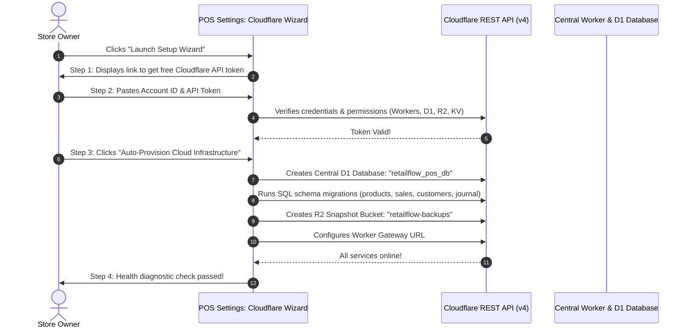
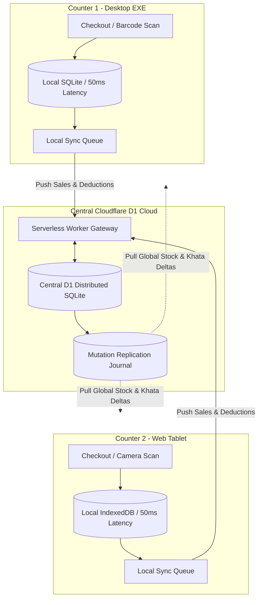

# RetailFlow POS - Complete Setup & Operations Guide

> **Enterprise Point of Sale System**  
> *Windows Desktop (EXE / MSI), Progressive Web App (PWA), Customer Cloudflare Architecture & Central D1 Distributed Database*

---

## 1. Quick Start & Publishing Assets

All release-ready binary artifacts have been prepared in the [`publish/`](./publish/) folder:

| File | Type | Architecture | Size | Description |
|---|---|---|---|---|
| [`RetailFlow_POS_v1.0.0_Setup.exe`](./publish/RetailFlow_POS_v1.0.0_Setup.exe) | NSIS Installer | Windows x64 | **3.54 MB** | **Recommended**: 1-click Windows installer with desktop & start menu shortcuts. |
| [`RetailFlow_POS_v1.0.0_Enterprise.msi`](./publish/RetailFlow_POS_v1.0.0_Enterprise.msi) | Windows MSI | Windows x64 | **4.77 MB** | Enterprise Windows Installer package for silent GPO / Intune IT deployment. |
| [`RetailFlow_POS_Portable.exe`](./publish/RetailFlow_POS_Portable.exe) | Standalone Binary | Windows x64 | **9.93 MB** | Portable zero-install executable ready to run immediately from flash drives. |
| [`RetailFlow_POS_v1.0.0_x64-setup.nsis.zip`](./publish/RetailFlow_POS_v1.0.0_x64-setup.nsis.zip) | Update Bundle | Windows x64 | **3.54 MB** | Compressed differential patch archive for native Tauri Auto-Updater. |
| [`latest.json`](./publish/latest.json) | Release Manifest | All | JSON | Remote manifest polled by desktop app for automated background updates. |
| [`checksums.txt`](./publish/checksums.txt) | SHA-256 Hashes | All | Plain Text | Cryptographic verification checksums for software integrity. |
| [`RETAILFLOW_POS_SETUP_GUIDE.pdf`](./RETAILFLOW_POS_SETUP_GUIDE.pdf) | User Manual | All | **76 KB** | Executive multi-page printable PDF manual. |

---

## 2. Installation & Running Options

### Option A: Windows Setup Installer (`.exe`) - Recommended for POS Terminals
1. Download or open `publish/RetailFlow_POS_v1.0.0_Setup.exe`.
2. Follow the standard Windows setup wizard (defaults to `C:\Program Files\RetailFlow POS`).
3. Launch via the **Desktop shortcut** or Windows Start menu.
4. All local data and SQLite databases are safely preserved across future auto-updates.

### Option B: Enterprise MSI Package (`.msi`) - For Network Administrators
Silent installation via command line:
```powershell
msiexec /i "RetailFlow_POS_v1.0.0_Enterprise.msi" /qn /norestart
```

### Option C: Portable Direct Executable (`.exe`)
Double-click `publish/RetailFlow_POS_Portable.exe` to run immediately with zero installation.

### Option D: Web Application & Local Network / Tablet POS
1. Start the server (already running as background daemon):
   ```bash
   pnpm --dir pos dev:web
   ```
2. Open your browser:
   * **Local POS Terminal**: `http://localhost:3000`
   * **Mobile / Tablet POS on Store Wi-Fi**: `http://<your-ip>:3000` (e.g. `http://192.168.1.10:3000`)
3. Scan the pairing QR code from the desktop Header button to instantly link mobile tablets.

---

## 3. First-Time Store Onboarding & Dynamic UPI QR Setup

### 3.1 Basic Store Profile
1. Go to **Settings > Shop Details & Logo**.
2. Enter your **Shop Name**, **Address**, **Phone**, **Email**, and **GSTIN**.
3. Upload your store logo (PNG, JPEG, or SVG). The logo is automatically scaled and rendered on thermal receipts, A4 tax invoices, and the PIN lock screen.

### 3.2 Dynamic NPCI UPI QR Configuration
1. In **Settings > Shop Details & Logo**, locate the **Dynamic UPI QR Payment Configuration** section.
2. Enter your Merchant UPI VPA (e.g. `merchant@okaxis` or `9876543210@paytm`).
3. Scan the live test card with Google Pay, PhonePe, or Paytm to verify receipt of test payments.
4. When ringing up sales in POS checkout:
   * Select **UPI** tender.
   * A full-screen dynamic QR appears with the **exact bill amount** auto-filled.
   * Upon customer payment, click **Complete Sale**.
   * Printed thermal receipts (80mm/58mm) and A4 invoices include the dynamic QR code automatically.

---

## 4. Customer Self-Service Cloudflare Setup Wizard

RetailFlow POS provides a 100% visual setup wizard requiring **zero terminal commands**:



### Steps to Connect:
1. Open **Settings > Cloudflare Sync & Backup**.
2. Click **"Launch Setup Wizard"** on the orange banner.
3. Follow the guided link to generate your Cloudflare API token with `Edit Cloudflare Workers` template.
4. Click **Verify & Continue**.
5. Click **Auto-Provision Cloud Infrastructure**.
6. Click **Save & Connect POS Terminals** and test your live Executive Dashboard at `https://retailflow-pos-cloud.<subdomain>.workers.dev`.

---

## 5. Centralised Database (Cloudflare D1) & Delta Replication



### Multi-Terminal Features:
1. **Zero-Latency Checkout**: Local checkouts execute in under 50ms without waiting for internet round-trips.
2. **Real-Time Stock Decrements**: When Counter 1 sells an item, Cloudflare D1 atomically decrements central stock and Counter 2 automatically pulls the update.
3. **Customer Khata (Store Credit)**: Customer balances and credit limits remain synchronized across all terminals.
4. **Offline Resilience**: If internet connectivity drops, POS continues ringing up sales normally and syncs queued transactions automatically when reconnected.

---

## 6. Centralised Auto-Updates

### 6.1 Windows Desktop EXE
* **Tauri Auto-Updater**:
  * Configured in `tauri.conf.json` with Ed25519 cryptographic public key.
  * Polls release repository on startup and every 5 minutes in background.
  * Click the **Sparkles** (`✨`) icon in the header to manually check for updates.
  * Interactive modal shows version comparison (`v1.0.0` -> `v1.1.0`), release notes, and progress bar.
  * Clicking **Download & Restart** installs the differential update and restarts seamlessly.

### 6.2 Web Continuous Deployment
* **Zero-Downtime PWA Updates**:
  * Background worker checks `/version.json`.
  * Non-intrusive floating toast: *"New POS Web Update Available! [Refresh to Apply]"*.
  * Never interrupts active carts or customer payments.

---

## 7. How to Publish Releases to Git & GitHub

### Step 1: Create a Git Tag
```bash
git add .
git commit -m "chore: release v1.0.0 production binaries and setup guide"
git tag v1.0.0
git push origin main --tags
```

### Step 2: Publish via GitHub CLI (`gh`)
```bash
gh release create v1.0.0 \
  publish/RetailFlow_POS_v1.0.0_Setup.exe \
  publish/RetailFlow_POS_v1.0.0_Enterprise.msi \
  publish/RetailFlow_POS_Portable.exe \
  publish/RetailFlow_POS_v1.0.0_x64-setup.nsis.zip \
  publish/latest.json \
  publish/checksums.txt \
  publish/RETAILFLOW_POS_SETUP_GUIDE.pdf \
  --title "RetailFlow POS v1.0.0" \
  --notes "Production Release of RetailFlow POS with Windows Setup and MSI installers, Dynamic UPI QR payments, Customer Cloudflare Wizard, and Central D1 database synchronization."
```

### Step 3: Or via GitHub Web Interface
1. Go to `https://github.com/Juhamim/retailpos/releases/new`.
2. Select tag `v1.0.0`.
3. Drag and drop all files from the `publish/` directory.
4. Click **Publish Release**!
